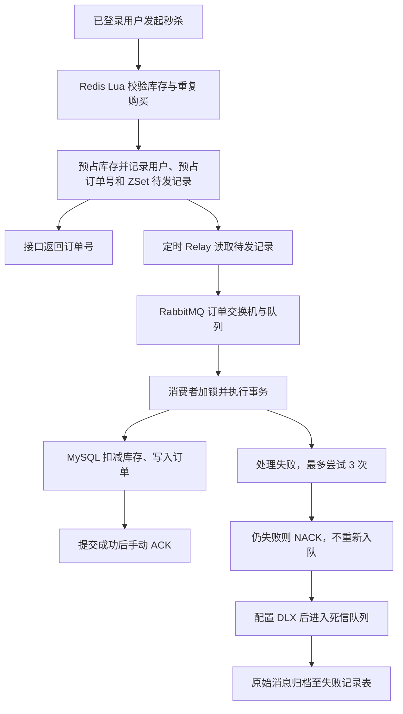

# 黑马点评 · Redis 与 RabbitMQ 实战

基于 Spring Boot 的本地生活点评学习项目，提供商铺查询、优惠券秒杀、探店笔记、点赞关注和用户签到等功能。项目以黑马点评课程为基础，进一步实践 RabbitMQ 异步下单、消息确认、失败归档与订单补偿，并补充签到日历等交互。

项目采用前后端分离结构：后端提供 REST 接口，前端通过 Nginx 托管静态页面，并将 `/api` 请求转发至后端。适合学习 Redis 数据结构、缓存策略、分布式锁，以及异步订单链路中的重试与幂等处理。

## 功能一览

| 模块 | 已实现功能 | 主要实现方式 |
| --- | --- | --- |
| 用户登录 | 手机验证码登录、首次登录自动注册、退出登录、登录态续期 | Redis 保存验证码和 Token，拦截器恢复用户信息 |
| 商铺查询 | 商铺分类、名称搜索、详情查询、附近商铺查询 | MyBatis-Plus 分页、Redis 缓存与 GEO |
| 优惠券 | 普通券与秒杀券创建、店铺优惠券列表 | MySQL 保存券信息，创建秒杀券时写入 Redis 库存 |
| 秒杀下单 | 库存预占、一人一单校验、异步创建订单、订单状态查询 | Lua、Redis 待发记录、RabbitMQ、Redisson、数据库事务 |
| 探店笔记 | 发布笔记、图片上传、热门笔记、笔记详情、点赞与取消点赞 | MySQL 保存内容，Redis ZSet 保存点赞用户 |
| 社交关注 | 关注与取消关注、共同关注、关注动态滚动分页 | Redis Set 交集、ZSet Feed 流 |
| 用户签到 | 每日签到、今日签到状态、连续签到统计、年度签到日历 | Redis Bitmap、前端 ECharts 日历展示 |
| 失败治理 | 死信归档、失败订单核查、受控重投与取消补偿 | 失败记录表、恢复状态表、补偿 Lua 与定时任务 |

> 验证码通过后端 DEBUG 日志模拟发送。失败订单核查、重投和取消目前提供服务层及测试入口，尚未提供管理页面或管理 API。

## 技术栈

| 技术 | 版本 / 用途 |
| --- | --- |
| Java | 17 |
| Spring Boot | 2.7.18，Web、依赖注入与事务管理 |
| MyBatis-Plus | 3.5.3.1，数据库访问与分页 |
| MySQL | 业务数据存储；当前 Connector/J 为 5.1.47 |
| Redis / Spring Data Redis | 登录态、缓存、库存预占、社交关系与签到 |
| Redisson | 3.16.3，订单分布式锁 |
| RabbitMQ / Spring AMQP | 异步订单、生产者确认与消费者手动 ACK |
| Hutool | 5.7.17，常用工具 |
| Vue / Element UI / Axios / ECharts | 静态前端页面、接口请求与签到可视化 |
| Nginx | 本地前端配套目录使用 1.18.0，负责静态资源与反向代理 |
| JUnit 5 / Mockito / H2 | 单元测试与局部数据库逻辑验证 |

## 核心实现

### 登录与缓存

- 使用 UUID Token 标识登录态，将用户信息存入 Redis Hash；请求携带 `authorization` 请求头。
- 通过双拦截器完成登录态续期与鉴权，使用 `ThreadLocal` 保存当前请求的用户信息，并在请求结束后清理。
- 商铺详情当前使用缓存查询与空值缓存，减少重复查询并应对缓存穿透；更新商铺时先更新数据库，再删除缓存。
- `CacheClient` 还保留互斥重建、逻辑过期等学习实现，商铺详情入口当前启用的是 `queryWithPassThrough`。

### 秒杀与异步订单



- **Redis 预占**：Lua 在一次脚本执行中检查库存与购买记录，扣减库存，并写入订单预占信息和待发记录。
- **待发记录**：ZSet 保存待投递订单；Relay 收到生产者 Confirm ACK、且未发生 Return 后才移除记录，未确认的消息保留重投。
- **消费幂等**：使用 Redisson 用户锁、数据库订单查询及 `(user_id, voucher_id)` 联合唯一索引处理重复投递。
- **事务落单**：通过 Spring 代理调用事务方法，在同一事务中执行带 `stock > 0` 条件的库存扣减与订单写入。
- **失败恢复**：死信先持久化再 ACK；核查失败记录后可重投，或先建立取消状态，再通过 Lua 幂等释放对应订单的 Redis 预占；定时任务继续处理待完成的取消补偿。

秒杀接口返回订单号表示请求已受理。前端通过状态接口查询最终结果：

| 状态 | 含义 |
| --- | --- |
| `NOT_READY` | 当前用户的订单尚未确认创建，也未确认取消，需继续查询或核查 |
| `CREATED` | 已在数据库中创建订单 |
| `CANCELLED` | 订单已完成取消补偿 |

## 项目目录

```text
hm-dianping/
├── pom.xml
├── README.md
├── docs/interview/                  # 技术复盘与代码验证材料
└── src/
    ├── main/
    │   ├── java/com/hmdp/
    │   │   ├── config/              # Web、Redis、RabbitMQ 与恢复表初始化配置
    │   │   ├── controller/          # REST 接口
    │   │   ├── dto/                 # 请求与响应对象
    │   │   ├── entity/              # 数据实体
    │   │   ├── mapper/              # 数据访问层
    │   │   ├── mq/                  # 消息投递、消费、死信与补偿任务
    │   │   ├── service/             # 业务接口与实现
    │   │   └── utils/               # 缓存、锁、ID 生成器与拦截器
    │   └── resources/
    │       ├── application.yaml
    │       ├── db/hmdp.sql          # 业务表与示例数据
    │       ├── db/order-recovery.sql # 订单恢复表与失败记录表
    │       ├── mapper/
    │       ├── seckill.lua          # 秒杀校验与库存预占
    │       ├── cancel-voucher-order.lua
    │       └── unlock.lua
    └── test/                       # 单元测试与中间件集成测试
```

前端目前位于本地独立目录 `nginx-1.18.0/html/hmdp/`，Nginx 配置位于 `nginx-1.18.0/conf/nginx.conf`，均不在当前后端仓库目录内。仅克隆本仓库可获取后端源码；运行完整页面还需要配套前端静态资源与 Nginx 配置。发布完整项目时，请将这两部分另行纳入版本管理或作为配套文件提供。

## 本地运行

以下命令以 Windows PowerShell 为例，路径请替换为自己的项目位置。

### 1. 准备环境

- JDK 17、Maven 3.x。
- MySQL：初始化脚本源自 MySQL 5.6，使用其他版本时需核对 SQL 与当前 JDBC 驱动的兼容性。
- 单机 Redis、RabbitMQ，以及配套 Nginx 和前端静态资源。
- 后端默认监听 `8081`，前端 Nginx 默认监听 `8080`。

### 2. 初始化数据库

登录 MySQL：

```powershell
mysql -u root -p
```

在 MySQL 客户端中执行：

```sql
CREATE DATABASE IF NOT EXISTS hmdp CHARACTER SET utf8mb4;
USE hmdp;
SOURCE D:/ProApp/java_project/Code/hm-dianping/src/main/resources/db/hmdp.sql;
SOURCE D:/ProApp/java_project/Code/hm-dianping/src/main/resources/db/order-recovery.sql;
```

`hmdp.sql` 包含删表重建语句，请导入专用的本地开发库。应用启动时还会检查恢复表及订单唯一索引，并可能执行建表或修改表结构，开发数据库账号需具备相应权限；存量订单存在重复数据时，需要先处理重复记录并确认唯一索引已建立。

### 3. 修改连接与文件路径

需要检查以下三处：

| 文件 | 配置内容 |
| --- | --- |
| `src/main/resources/application.yaml` | MySQL、Redis、RabbitMQ 地址及账号密码 |
| `src/main/java/com/hmdp/config/RedissionConfig.java` | Redisson 使用独立连接配置，需要与应用 Redis 指向同一个实例 |
| `src/main/java/com/hmdp/utils/SystemConstants.java` | `IMAGE_UPLOAD_DIR` 改为本机 Nginx 的 `html/hmdp/imgs` 绝对路径 |

例如，可将 `application.yaml` 中的连接字段改为以下环境变量形式，并保留原有的连接池、Jackson、MyBatis-Plus 等其他配置：

```yaml
spring:
  datasource:
    url: jdbc:mysql://${DB_HOST:127.0.0.1}:${DB_PORT:3306}/hmdp?useSSL=false&serverTimezone=UTC
    username: ${DB_USERNAME:root}
    password: ${DB_PASSWORD}
  redis:
    host: ${REDIS_HOST:127.0.0.1}
    port: ${REDIS_PORT:6379}
    password: ${REDIS_PASSWORD}
  rabbitmq:
    host: ${RABBITMQ_HOST:127.0.0.1}
    port: ${RABBITMQ_PORT:5672}
    username: ${RABBITMQ_USERNAME}
    password: ${RABBITMQ_PASSWORD}
    virtual-host: /
    publisher-confirm-type: correlated
    publisher-returns: true
    template:
      mandatory: true
```

这是配置调整示例，当前源码尚未统一完成环境变量改造；`RedissionConfig.java` 中的连接地址和密码仍需同步处理。未设置密码的 Redis 实例，应同时移除两处 Redis 密码配置。

### 4. 配置 RabbitMQ 死信路由

应用会声明以下交换机、队列与绑定，连接账号需拥有对应虚拟主机的配置、读写权限：

| 用途 | 交换机 | 队列 | Routing Key |
| --- | --- | --- | --- |
| 订单创建 | `hmdp.voucher.order.direct` | `hmdp.voucher.order.queue` | `voucher.order.create` |
| 死信归档 | `hmdp.voucher.order.dlx` | `hmdp.voucher.order.dlq` | `voucher.order.dead` |

当前代码声明了死信交换机和队列，但业务队列没有在代码中绑定 DLX。需要在 RabbitMQ 管理端为业务队列设置 Policy：

| Policy 字段 | 值 |
| --- | --- |
| Virtual host | 与应用一致，默认 `/` |
| Pattern | `^hmdp\.voucher\.order\.queue$` |
| Apply to | Queues |
| `dead-letter-exchange` | `hmdp.voucher.order.dlx` |
| `dead-letter-routing-key` | `voucher.order.dead` |

确认该策略已作用于业务队列后，再验证失败消息归档链路。缺少这项配置时，消费者拒绝且不重新入队的消息无法进入上述死信队列。

### 5. 启动后端

在后端项目根目录执行：

```powershell
mvn spring-boot:run
```

也可在 IDE 中运行 `com.hmdp.HmDianPingApplication`。后端启动后，可访问 [商铺分类接口](http://localhost:8081/shop-type/list) 检查基础服务。

如需打包运行：

```powershell
mvn package -DskipTests
java -jar target/hm-dianping-0.0.1-SNAPSHOT.jar
```

此处打包跳过测试，测试运行方式见下文。

### 6. 启动前端与 Nginx

配套 `conf/nginx.conf` 的主要路由为：

```nginx
server {
    listen 8080;
    server_name localhost;

    location / {
        root html/hmdp;
        index index.html index.htm;
    }

    location /api/ {
        proxy_pass http://127.0.0.1:8081/;
        proxy_http_version 1.1;
        proxy_set_header Host $host;
    }
}
```

这是 `http` 块内的最小配置示例；现有配套配置通过 `rewrite` 去掉 `/api` 前缀，实现相同的接口转发。前端 `js/common.js` 的请求基础路径为 `/api`。

在 Nginx 根目录执行：

```powershell
Set-Location D:\ProApp\java_project\Code\nginx-1.18.0
.\nginx.exe -t
Start-Process -FilePath .\nginx.exe -WindowStyle Hidden
```

修改已有配置后可执行 `.\nginx.exe -s reload`，停止可执行 `.\nginx.exe -s quit`。

访问 [项目首页](http://localhost:8080) 或 [验证码登录页](http://localhost:8080/login.html)。点击发送验证码后，从后端 DEBUG 日志中取得验证码并完成登录。

### 7. 准备演示数据

- **附近商铺**：数据库导入不会自动建立 Redis GEO 索引。连接好中间件后，在后端根目录执行 `mvn "-Dtest=HmDianPingApplicationTests#loadShopData" test`，将商铺坐标导入 Redis。
- **秒杀库存**：通过 `POST /voucher/seckill` 创建秒杀券时会同步初始化 Redis 库存。仅导入 MySQL 数据后，已有秒杀券仍需核对并初始化对应的 `seckill:stock:{voucherId}`。
- **时间与库存**：演示时使用当前有效的活动时间与库存；已有预占或订单的活动，应先核对 Redis 与 MySQL 记录，再调整数据。

## 常用接口

以下路径为后端实际路径。通过前端 Nginx 访问时需添加 `/api` 前缀，例如 `/api/shop-type/list`；需登录的请求携带 `authorization: <token>`。

| 方法 | 路径 | 说明 |
| --- | --- | --- |
| POST | `/user/code?phone=手机号` | 获取验证码 |
| POST | `/user/login` | 验证码登录 |
| POST | `/user/logout` | 退出登录 |
| GET | `/user/me` | 当前用户 |
| GET | `/shop-type/list` | 商铺分类 |
| GET | `/shop/{id}` | 商铺详情 |
| GET | `/shop/of/type?typeId=1&current=1` | 分类查询，可附加 `x`、`y` 坐标 |
| GET | `/voucher/list/{shopId}` | 店铺优惠券列表 |
| POST | `/voucher/seckill` | 创建秒杀优惠券 |
| POST | `/voucher-order/seckill/{id}` | 秒杀下单，返回订单号 |
| GET | `/voucher-order/status/{orderId}` | 查询当前用户的订单状态 |
| GET | `/blog/hot?current=1` | 热门笔记 |
| POST | `/blog` | 发布笔记 |
| PUT | `/blog/like/{id}` | 点赞或取消点赞 |
| GET | `/blog/of/follow` | 关注动态，使用 `lastId`、`offset` 滚动分页 |
| PUT | `/follow/{id}/{isFollow}` | 关注或取消关注 |
| GET | `/follow/common/{id}` | 共同关注 |
| POST | `/user/sign` | 每日签到 |
| GET | `/user/sign/status` | 今日签到状态 |
| GET | `/user/sign/count` | 连续签到天数 |
| GET | `/user/sign/calendar?year=2026` | 指定年份的签到日历 |

## 测试与验证

以下测试使用 Mockito 或 H2，可单独验证签到、Feed 和订单恢复的部分逻辑：

```powershell
mvn "-Dtest=UserServiceImplTest,BlogServiceImplTest,OrderRecoverySafetyTest" test
```

其他 `@SpringBootTest` 测试需要先配置 MySQL、Redis、RabbitMQ；其中部分测试会发送消息或写入数据，应在独立开发环境中运行。真实 Redis 补偿测试与失败订单操作测试通过系统属性显式启用，运行前请阅读对应测试源码。

局部测试与端到端验证覆盖不同范围。完整秒杀验证还需检查库存、订单数、待发记录、队列消息以及失败记录之间是否一致。

## 当前边界与后续完善

- 秒杀后端当前校验库存及重复购买，活动开始、结束时间的强制服务端校验仍需补充；前端已有时间判断。
- Lua 和 Redisson 当前按单机 Redis 设计，迁移 Redis Cluster 前需调整多 Key 的访问方式。
- Redis 预占、RabbitMQ 投递和 MySQL 落单涉及多个系统，故障恢复效果仍需结合持久化配置、死信策略及实际故障演练验证。
- 后续可补充配置统一管理、失败订单管理入口、链路监控及完整压力测试。


本项目用于课程学习与技术实践，基础业务及配套素材来源于黑马点评课程，扩展内容用于记录个人学习过程。使用或分发课程素材时，请遵守其原有授权要求。
