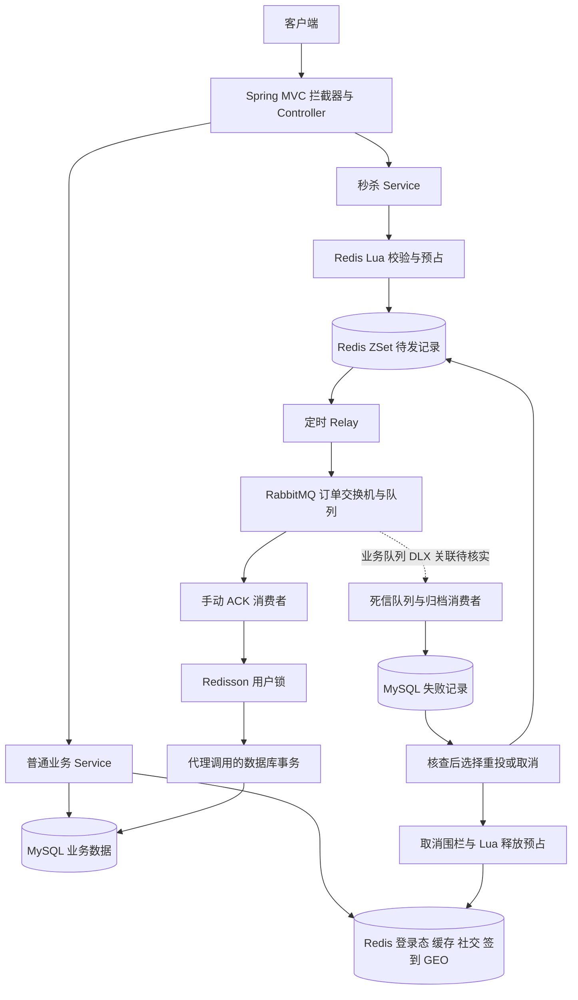
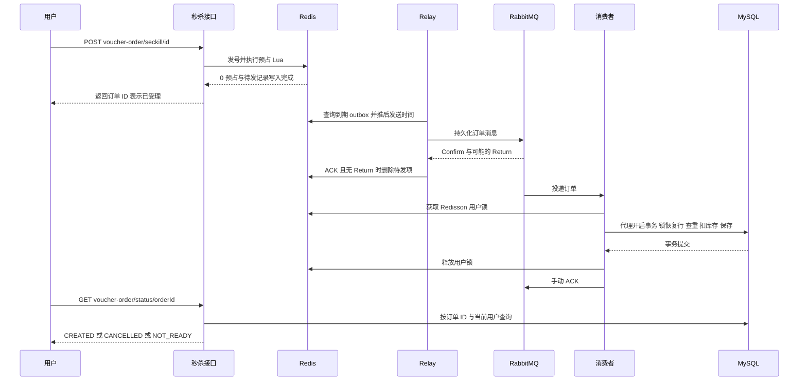

# 黑马点评业务与技术演进复盘

面向 Java 后端校招：普通业务讲清需求和实现，重点深入秒杀、分布式锁与异步消息一致性。前期功能来自课程实践，RabbitMQ 改造由 AI 辅助完成，改造目标是学习消息确认、重试与失败治理，没有性能优于 Redis Stream 的实验结论。

核对日期：2026 年 11 月 21 日。提交基线：`8185225fbd2685cb4ec0f552592c5c9f3d8da5c5`。分析同时纳入本地未跟踪补偿代码，以及核对期间新增的联合唯一索引、存量库补索引逻辑和重复键异常处理，均属于未提交状态。截图提供两条业务主线，实际启用状态、历史顺序与验证结论以仓库证据为准。

配套阅读：[校招面试材料](D:/ProApp/java_project/Code/hm-dianping/docs/interview/校招面试材料.md)、[代码证据与验证清单](D:/ProApp/java_project/Code/hm-dianping/docs/interview/代码证据与验证清单.md)。后者提供精确代码入口、提交记录和测试边界。

## 一 项目业务与架构

项目是本地生活点评场景的单体后端。用户通过验证码登录，浏览商铺、发现附近商铺，发布笔记、点赞、关注、查看关注动态、签到，并参与优惠券秒杀。秒杀的业务约束是库存不能扣成负数、同一用户同一优惠券只能购买一次，以及异步受理的请求最终能够被核查。

技术栈来自 pom：Java 17、Spring Boot 2.7.18、MyBatis Plus 3.5.3.1、Redis、Redisson 3.16.3、RabbitMQ 与 MySQL。MySQL 驱动版本不能推断 MySQL 服务端版本；当前没有 Redis 和 RabbitMQ 服务端版本、集群部署的核实记录。

图是当前工作区的逻辑架构，不代表已部署多实例或微服务。取消围栏、补偿服务和恢复任务依赖未跟踪文件；业务队列到死信交换机的关联还需要代码参数或 broker policy 的证据。

### 当前状态总览

| 状态 | 范围 | 面试表述 |
| --- | --- | --- |
| 当前生效代码 | Redis 登录、商铺空值缓存、点赞关注 Feed、签到 GEO、Lua 预占、ZSet outbox、RabbitMQ Relay 与消费者 | 已有实现；具体运行效果由对应测试范围限定 |
| 已封装但入口未启用 | 商铺互斥重建、逻辑过期重建 | 实现并比较过策略，不能说当前详情入口正在使用 |
| 历史方案 | synchronized、手写 Redis 订单锁、直接 Stream 消费 | 有提交证据；部分中间版本混杂，不能全部称为稳定版本 |
| 工作区补偿原型 | 恢复表行锁、取消围栏、匹配预占释放、定时恢复、人工核查入口 | 有实质代码和局部测试；尚未完整提交及验证全链路 |
| 待验证或改进 | DLX 关联、真实库唯一约束、故障恢复闭环、Redis 持久化与淘汰策略、吞吐与延迟 | 风险或后续方案，不能包装成已完成成果 |

仓库完整性还有一个实际问题：HEAD 的订单服务和 Relay 已依赖 `OrderRecoveryStore`，但该类等文件尚未纳入 Git。当前工作区能够编译，不等于别人只检出 HEAD 就能复现。

## 二 真实提交路线

| 提交 | 主要变化 | 需要保留的历史边界 |
| --- | --- | --- |
| `96d6f67` | 验证码与 Redis 登录态 | 该快照已使用 Redis；Session 是需求推导和注释中的前置方案 |
| `e5a2a69` | 商铺缓存及击穿策略 | 早期缓存锁使用固定值和直接删除 |
| `f4a2f7f` | 同步秒杀、活动时间校验、条件扣库存、用户 synchronized | 没有 version 字段；快照有异常裸字符，未证明可编译 |
| `2d2d2f6` | 手写 Redis 订单锁 | SET NX EX、归属标识、Lua 解锁，没有自动续期 |
| `64e2af8` | Redisson 订单锁 | 使用普通 RLock，未使用公平锁或 RedLock |
| `6653636`、`38bfe6a` 等中间阶段 | 进程内队列与 Stream 改造交叉 | 存在队列生产消费不匹配、ACK key 不一致等问题 |
| `1e6c164` | 登录与缓存代码完善 | 缓存锁归属校验、有界重试、二次检查等改进 |
| `dc5a688` | Stream 参数、消费入口、ACK 目标修复 | 有完整链路代码；事务代理仍依赖请求初始化 |
| `55e0848` | 注入自身代理、消费组处理、其余业务完善 | Stream 锁失败直接返回可能被上层 ACK，Pending 恢复仍有限 |
| `8185225` | RabbitMQ 替换直接 Stream 消费 | Lua 改写 ZSet outbox，Relay 转发；已提交代码仍依赖未跟踪补偿文件 |

教学叙述可以解释“为什么需要进程内异步、再引入外部队列”，但真实历史应说明中间版本存在不完整改造。不能把提交标题等同于每个阶段都稳定上线过。

## 三 普通业务技术演进

以下每条均按“遇到的问题 → 原方案缺陷 → 技术选型 → 代码实现 → 解决效果 → 遗留风险”展开。“解决效果”首先描述机制变化，只有经过相应测试才增加验证结论。

### 登录从进程内会话走向共享状态

| 环节 | 复盘 |
| --- | --- |
| 遇到的问题 | 用户需要验证码登录，后续请求要识别身份；多实例场景需要共享登录态。 |
| 原方案缺陷 | 本机 Session 如果没有共享机制，请求切换实例可能找不到登录态。仓库没有多节点 Session 故障实验，不能称为已在线上遇到。 |
| 技术选型 | Redis String 保存短期验证码，UUID Token 作为不透明凭证，Hash 保存精简 UserDTO，TTL 管理失效。 |
| 代码实现 | UserServiceImpl 校验验证码、查建用户、写 Hash；RefreshTokenInterceptor 先解析 Token、写 ThreadLocal 并续期，LoginInterceptor 再判断受保护请求；afterCompletion 清理 ThreadLocal；登出删除 Token。 |
| 解决效果 | 登录状态不绑定某个应用进程；请求内读取用户无需反复传参。代码是共享 Token 会话方案，不是 JWT。 |
| 遗留风险 | 短信仅日志模拟；未见验证码限频、错误次数控制与成功后删除；写 Hash 与 expire 分离。登录 TTL 实际是 36000 分钟，约 25 天，需要业务确认。ThreadLocal 不会自动传给消费者线程。 |

代码入口：[UserServiceImpl](D:/ProApp/java_project/Code/hm-dianping/src/main/java/com/hmdp/service/impl/UserServiceImpl.java:62)、[Token 拦截器](D:/ProApp/java_project/Code/hm-dianping/src/main/java/com/hmdp/utils/RefreshTokenInterceptor.java:28)。

### 商铺查询从数据库回源到空值缓存

| 环节 | 复盘 |
| --- | --- |
| 遇到的问题 | 商铺信息反复读取；不存在的商铺 ID 也可能反复请求数据库。 |
| 原方案缺陷 | 每次查库增加数据库查询次数；普通缓存只缓存存在数据时，无效 ID 仍持续回源。 |
| 技术选型 | Cache Aside：命中 Redis 返回，未命中查 MySQL 后缓存；不存在的数据缓存空字符串。 |
| 代码实现 | ShopServiceImpl.queryById 当前调用 queryWithPassThrough；正常数据 TTL 为 30 分钟，空值 TTL 为 2 分钟；更新商铺先更新数据库再删除详情缓存。 |
| 解决效果 | 缓存有效且命中时省去本次详情数据库查询；同一无效 ID 的后续请求在空值 TTL 内不会回源。 |
| 遗留风险 | 随机无效 ID 仍可能形成穿透；没有布隆过滤器和限流实现。删缓存失败无重试，并发旧读仍可能回填旧数据；没有强一致保证。 |

代码入口：[当前查询与更新](D:/ProApp/java_project/Code/hm-dianping/src/main/java/com/hmdp/service/impl/ShopServiceImpl.java:55)、[空值缓存](D:/ProApp/java_project/Code/hm-dianping/src/main/java/com/hmdp/utils/CacheClient.java:54)。

### 热点缓存从同时回源到互斥重建和逻辑过期

| 环节 | 复盘 |
| --- | --- |
| 遇到的问题 | 热点 key 物理过期后，大量请求可能同时查数据库，形成缓存击穿。 |
| 原方案缺陷 | 空值缓存处理不存在的数据，不能阻止真实热点过期后的并发回源；早期固定锁值和直接 DEL 还可能误删后继持有者的锁。 |
| 技术选型 | 互斥重建让请求等待一个持有者回填；逻辑过期保留旧值，由获得重建锁的请求发起异步更新，其他请求继续读旧值。 |
| 代码实现 | CacheClient 封装两种方法；互斥方案最多 20 轮、每轮等待 50ms，拿锁后二次检查；锁值为 UUID 前缀与线程 ID，Lua 比较后删除；逻辑过期记录 data 与 expireTime，用线程池重建并捕获原锁值释放。 |
| 解决效果 | 在锁租约有效等前提下减少重复重建；逻辑过期以允许短暂旧数据换取请求无需等待重建。两种入口在当前 queryById 中都被注释，不能认定当前接口获得了这些效果。 |
| 遗留风险 | 锁固定 10 秒，不续期；互斥重试耗尽会直接回源。逻辑过期依赖预热，缓存 miss 直接返回 null；数据格式与普通缓存不同，切换须迁移。线程池任务队列无界；未见 TTL 随机抖动治理雪崩。 |

代码入口：[逻辑过期](D:/ProApp/java_project/Code/hm-dianping/src/main/java/com/hmdp/utils/CacheClient.java:85)、[互斥重建](D:/ProApp/java_project/Code/hm-dianping/src/main/java/com/hmdp/utils/CacheClient.java:138)。

### 社交互动从查关系到 Redis 集合

| 环节 | 复盘 |
| --- | --- |
| 遇到的问题 | 判断是否点赞、展示点赞用户、计算共同关注、获取关注动态，需要关系查询、排序和分页。 |
| 原方案缺陷 | 单独的点赞计数无法表达谁点赞；普通页码分页在动态新增时可能发生偏移；逐条比对共同关注不便。 |
| 技术选型 | 点赞用 ZSet，member 为用户 ID、score 为点赞时间；关注用 Set 做交集；Feed 收件箱用 ZSet，时间戳作为滚动分页游标。 |
| 代码实现 | BlogServiceImpl 先查 score，再更新 DB 计数和 ZSet；FollowServiceImpl 保存 DB 关系后更新 Set，SINTER 求共同关注；发笔记后同步逐个写粉丝收件箱；查询用 max、offset，处理同分值连续跨页并按返回 ID 顺序回查 DB。 |
| 解决效果 | Redis 直接支持成员判断、时间维度排序、集合交集与游标读取；避免只用页码表示动态位置。当前点赞展示使用正序 range，取的是最早点赞的五人。 |
| 遗留风险 | 点赞“判断后更新”不是原子操作，并发可使 DB 计数与去重成员不一致；关注 DB/Redis 双写也可能失败。Feed 是同步推模式，大粉丝量写放大，部分投递无补偿，收件箱未裁剪。 |

代码入口：[点赞](D:/ProApp/java_project/Code/hm-dianping/src/main/java/com/hmdp/service/impl/BlogServiceImpl.java:103)、[Feed 发布](D:/ProApp/java_project/Code/hm-dianping/src/main/java/com/hmdp/service/impl/BlogServiceImpl.java:67)、[滚动分页](D:/ProApp/java_project/Code/hm-dianping/src/main/java/com/hmdp/service/impl/BlogServiceImpl.java:194)、[共同关注](D:/ProApp/java_project/Code/hm-dianping/src/main/java/com/hmdp/service/impl/FollowServiceImpl.java:92)。

### 签到与附近商铺采用专用数据结构

| 环节 | 复盘 |
| --- | --- |
| 遇到的问题 | 签到要判断某天是否签到、统计连续天数；附近商铺要按坐标圈定候选范围。 |
| 原方案缺陷 | 每日签到逐条关系记录和应用层距离遍历可以实现，但不能直接利用位运算和空间索引。未测量过两种方案的实际成本差异。 |
| 技术选型 | Bitmap 按用户与月份存签到位；GEO 按商铺类型保存坐标和商铺 ID。 |
| 代码实现 | SETBIT 用当天日期减一作为偏移；GETBIT/BITFIELD 读取状态和连续位，并实现今天未签时截至昨天的连签、跨月统计与年历；GEO 查询半径 5 公里后截取候选 ID，再回查数据库补距离。 |
| 解决效果 | 按位表达每日布尔状态；空间查询先筛候选再取详情。一个 31 天月份的签到有效位最多 31 位，但不能把它当成包含 key、对象等开销的 Redis 总内存。 |
| 遗留风险 | 签到依赖 Redis 数据保留，未写入 SQL 签到表；时区依赖 JVM。GEO 初始化在测试导入代码中，商铺更新未同步 GEO；当前没有显式升序距离参数，不能保证最近优先。 |

代码入口：[签到](D:/ProApp/java_project/Code/hm-dianping/src/main/java/com/hmdp/service/impl/UserServiceImpl.java:164)、[附近商铺](D:/ProApp/java_project/Code/hm-dianping/src/main/java/com/hmdp/service/impl/ShopServiceImpl.java:103)。

## 四 秒杀与锁的演进

### 条件扣库存与一人一单分别解决两个约束

| 环节 | 复盘 |
| --- | --- |
| 遇到的问题 | 并发请求可能读到同一库存；同一用户也可能多次下单。 |
| 原方案缺陷 | Java 先读库存再无条件写回，有检查与写入的竞争窗口；只防库存负数不能阻止同一用户买多份。 |
| 技术选型 | 数据库原子条件更新负责库存，用户粒度互斥负责把“查重与落单”串行化；扣库存和保存订单处于同一事务。 |
| 代码实现 | 当前仍使用 `UPDATE ... SET stock=stock-1 WHERE voucher_id=? AND stock>0`；用户和券联合查询订单是否存在。早期提交使用 synchronized 与 Spring 代理调用事务。 |
| 解决效果 | 条件更新不依赖外部先读结果来决定扣减；更新行数为零时按失败处理。条件扣减常被教程归为乐观并发控制，但项目没有 version 字段，也不是比较“旧库存值”的 CAS。 |
| 遗留风险 | 查重本身不是数据库唯一约束。HEAD 只有订单 ID 主键；本地 SQL 已补用户与券联合唯一索引，未验证真实数据库是否应用。事务只能保证数据库内的一组操作，不能覆盖 Redis 或 RabbitMQ。 |

### synchronized 走向手写 Redis 分布式锁

| 环节 | 复盘 |
| --- | --- |
| 遇到的问题 | 应用多进程运行时，同一用户请求可能进入不同 JVM。 |
| 原方案缺陷 | synchronized 的监视器只在本 JVM 内有效；给不同 JVM 的对象加锁不能形成全局互斥。 |
| 技术选型 | Redis `SET key owner NX EX ttl`，竞争共享锁 key；owner 用 JVM UUID 前缀与线程 ID 区分持有者。 |
| 代码实现 | SimpleRedisLock.tryLock 用带过期参数的 setIfAbsent，一次完成占位和租约设置；unlock.lua 比较 owner 一致后 DEL，避免比较和删除之间再发生切换。 |
| 解决效果 | 不同 JVM 可以在同一 Redis 上竞争用户锁；持有者异常后锁可过期；旧线程解锁不会直接删除归属不符的新锁。 |
| 遗留风险 | 固定租约可能早于业务结束；Lua 安全解锁不能阻止已失去租约的旧线程继续写数据库。无可重入计数、无自动续期；Redis 故障切换等安全性未验证。 |

代码入口：[手写锁](D:/ProApp/java_project/Code/hm-dianping/src/main/java/com/hmdp/utils/SimpleRedisLock.java:31)、[Lua 解锁](D:/ProApp/java_project/Code/hm-dianping/src/main/resources/unlock.lua:1)。

### 手写锁走向 Redisson

| 环节 | 复盘 |
| --- | --- |
| 遇到的问题 | 手动维护归属、重入、等待和续期逻辑复杂，固定租约难覆盖不确定的数据库耗时。 |
| 原方案缺陷 | 单纯延长租约会延长异常后的阻塞；租约过短又可能使两个业务线程先后持锁但同时执行。 |
| 技术选型 | Redisson 普通 RLock，复用库的可重入和未显式指定租约时的续期机制。 |
| 代码实现 | handleVoucherOrder 获取 `lock:order:` 加 userId；调用无参数 tryLock，失败抛异常进入消费重试；成功后 self.createVoucherOrder，在 finally 中解锁。 |
| 解决效果 | 应用不再自行实现订单锁的续期与重入协议；事务代理调用返回并提交后再执行解锁。 |
| 遗留风险 | 当前 tryLock 是不等待的竞争方式，不能说用上了带等待时间的阻塞抢锁。锁按用户串行化其全部优惠券，粒度偏粗；长暂停、网络故障与主从切换下仍需数据库约束兜底。未采用 fencing token。 |

可重入可以理解为“同一持有线程再次进入时增加持有计数，解锁相应减计数”，不表示所有相同 userId 的线程都能重入。Redisson 3.16.3 源码可核对未传 leaseTime 时的续期分支、Hash 计数和解锁逻辑。[对应版本源码](https://github.com/redisson/redisson/blob/redisson-3.16.3/redisson/src/main/java/org/redisson/RedissonLock.java)

**一个必须纠正的事务表述：**事务通常绑定线程，消费者不能继承请求线程事务；但消费者线程通过 Spring 代理调用事务方法，能够开启自己的事务。问题不是“多线程必然没有事务”，而是是否正确经过代理、使用同一事务资源以及提交时机。

## 五 从 Lua 预占到 Stream 异步落单

### Lua 将资格判断和预占放在同一个 Redis 执行单元

| 环节 | 复盘 |
| --- | --- |
| 遇到的问题 | 同步下单要等待数据库；把库存判断、重复判断和扣减拆成多次请求仍有竞争窗口。 |
| 原方案缺陷 | 单个 Redis 命令原子，不代表多条命令组成的业务判断原子；Java 先 GET 后 DECR 仍可能并发穿插。 |
| 技术选型 | 用短 Lua 脚本在 Redis 中判断库存和购买记录，成功后预占，并留下异步订单处理凭据。 |
| 代码实现 | 当前 seckill.lua 读取库存 key，返回 3 表示缺失、1 表示不足、2 表示已购；成功时扣库存、加入用户 Set、记录用户对应的预占订单号 Hash、写 ZSet outbox，返回 0。历史版最后一步是 XADD Stream。 |
| 解决效果 | 正常执行完成时，资格判断和预占不被其他客户端命令插入；请求线程不用等待数据库创建订单。Redis 库存是接入资格的预占账，MySQL 库存仍在消费事务中扣减。 |
| 遗留风险 | 当前未校验开始与结束时间，库存 key 存在不等于活动正在进行。脚本不覆盖数据库和 RabbitMQ；运行时出错不会自动撤销已经执行的写入。当前增加了部分 key 类型预检，但不能等同于完整故障回滚。 |

Redis 脚本的原子执行主要指执行期间不被其他客户端命令穿插，不能推导出跨系统原子提交。[Redis Lua 说明](https://redis.io/docs/latest/develop/programmability/eval-intro/) 自动回滚也不能从这一语义推出，Redis 项目的相关功能讨论明确区分了既有写入和中途退出。[Redis 回滚讨论](https://github.com/redis/redis/issues/10576)

还有部署边界：当前部分 key 在脚本中由 ARGV 拼接，且全局 outbox 与单券库存没有统一 hash tag。迁移 Redis Cluster 需要显式传入访问 key、设计同槽与分片方式，不能直接称为集群兼容。[Redis EVAL 约束](https://redis.io/docs/latest/commands/eval/)

### 从进程内队列过渡到 Redis Stream

| 环节 | 复盘 |
| --- | --- |
| 遇到的问题 | 异步线程需要接收订单任务，进程退出后还希望找回未完成任务。 |
| 原方案缺陷 | BlockingQueue 的任务位于进程内存，重启丢失；容量与消费者速度不匹配时积压；外部状态预扣与入本机队列也不能原子提交。历史中间提交还存在生产和消费方式未同步替换的问题。 |
| 技术选型 | Redis Stream + 消费组，用 Lua 同时预占与 XADD；消费成功再 XACK，失败记录留在待确认列表。 |
| 代码实现 | dc5a688 使用 stream.orders、g1/c1、阻塞读新消息，handleVoucherOrder 落库后 ACK；异常时以 ID 0 读取本消费者 Pending 处理。55e0848 注入 self 代理并补充建组和 NOGROUP 处理。 |
| 解决效果 | 与进程内队列相比，任务记录放到 Redis；可区分新消息与已投递未确认消息。是否能在机器故障后保留数据仍取决于 Redis 持久化与部署。 |
| 遗留风险 | Pending 恢复主要在异常后触发，启动恢复不足；使用固定消费者名，未见跨消费者接管治理；毒消息可能阻塞后续处理；缺少裁剪策略。历史锁失败直接 return，外层仍可能 ACK，造成业务未完成却确认。 |

Stream 的 PEL 是“已交给消费者但尚未确认”的 ID 集合。XACK 从 PEL 移除确认记录，不等于删除 Stream 正文；读 ID 0 通常只处理当前消费者自己的 Pending，不能概括成自动接管所有崩溃消费者。[XREADGROUP 说明](https://redis.io/docs/latest/commands/xreadgroup/)

## 六 RabbitMQ 改造与一致性

### 选择 RabbitMQ 的原因与代价

| 环节 | 复盘 |
| --- | --- |
| 遇到的问题 | 需要进一步学习发送确认、有限重试、失败归档和恢复，明确每个消息状态由谁负责。 |
| 原方案缺陷 | 项目的 Stream 消费循环将读取、Pending 恢复与业务处理耦合在一起，当前异常与失败治理较薄弱。这是该实现的不足，不能推导成 Redis Stream 不具备可靠消费能力。 |
| 技术选型 | RabbitMQ 承接订单传递与消费管理；保留 Redis 预占，用 Redis ZSet outbox 连接两个系统。 |
| 代码实现 | Lua 不再生效 XADD，改写待发成员；定时 Relay 转为 VoucherOrder JSON，发送到 DirectExchange、绑定业务队列；监听器通过手动 ACK 控制确认。 |
| 解决效果 | 消息投递、业务消费、失败记录形成独立环节，便于分析确认边界和恢复路径。改造由 AI 辅助，尚无 Stream 与 RabbitMQ 的对比压测。 |
| 遗留风险 | 新增 Redis 到 RabbitMQ 的跨系统窗口、多一套基础设施与排障成本；吞吐瓶颈可能转移到 Relay、DB 或调度器。选择更复杂，不天然等于更可靠。 |

### Redis ZSet outbox 处理预占后尚未发消息的窗口

| 环节 | 复盘 |
| --- | --- |
| 遇到的问题 | 如果 Lua 扣完库存后应用崩溃，紧接着执行的 RabbitTemplate 发送可能根本没发生。 |
| 原方案缺陷 | “先预占，再调用 RabbitMQ”是两个独立系统动作，普通 try/catch 无法覆盖进程突然退出。直接同步失败补库存也可能误处理“实际发出但确认丢失”的情况。 |
| 技术选型 | Lua 在 Redis 内同时留下待发记录；后台 Relay 发送，确认后删除，未确认保留重发。 |
| 代码实现 | member 为 orderId:userId:voucherId，score 为下次可发送时间，初始 0；fixedDelay 1 秒，每轮最多取 10 条到期项，先把 score 推后 10 秒，再逐条发送；等待 Confirm 最多 3 秒，ACK 且无 Return 才 ZREM。每次发送关联 ID 不同，业务订单 ID 不变。 |
| 解决效果 | 预占正常完成后，发送责任留在 Redis，应用重启可继续扫描；发送失败不只留下日志。它是 Redis 内的待发记录方案，不是把订单与消息写入同一个 MySQL 本地事务的数据库 Outbox。 |
| 遗留风险 | 读取和更新 score 不是原子认领，多实例可能同时发送；成功发送后删除前崩溃也会重发。逐条等待确认限制处理速度，“每轮 10 条”不能换算成项目 QPS。Redis 丢数据或淘汰该 key 仍可能失去恢复依据。 |

代码入口：[Lua outbox](D:/ProApp/java_project/Code/hm-dianping/src/main/resources/seckill.lua:42)、[Relay](D:/ProApp/java_project/Code/hm-dianping/src/main/java/com/hmdp/mq/VoucherOrderOutboxRelay.java:34)。

### Confirm 与 Return 核对发送结果

| 环节 | 复盘 |
| --- | --- |
| 遇到的问题 | 发送方法返回，只能说明客户端执行了发送操作，不能确认消息已经被正确接收和路由。 |
| 原方案缺陷 | 只打印回调日志无法恢复；只看 Confirm ACK 也可能忽略不可路由消息。 |
| 技术选型 | correlated Confirm、publisher returns、mandatory，并把检查结果与 outbox 删除关联。 |
| 代码实现 | application.yaml 已启用相关开关；Relay 对本次 CorrelationData 的 future 等待 ACK，并检查 getReturned；全局回调主要日志，实际重发责任来自 outbox 未删除。消息设置 persistent，交换机与队列声明 durable。 |
| 解决效果 | ACK 且未退回时才清除待发责任；超时、NACK、Return 或发送异常保留记录。 |
| 遗留风险 | Confirm 不表示业务已落库；超时是结果不确定，重发可能重复；持久化声明不代表已验证集群容灾。实际 broker 版本与配置仍需核实。 |

Confirm 关注生产者到 broker 的接收，Return 暴露 mandatory 消息无法路由，消费 ACK 关注 broker 到消费者的处理；这三个信号不能互相替代。不可路由消息也可能得到 Confirm ACK，所以 Relay 要同时检查 Return。[RabbitMQ 确认机制](https://www.rabbitmq.com/docs/confirms)

### 有限重试与手动 ACK 控制消费结果

| 环节 | 复盘 |
| --- | --- |
| 遇到的问题 | 短暂锁竞争、数据库异常可能恢复；永久错误又不能无限占用消费线程。 |
| 原方案缺陷 | 处理前 ACK 会在业务失败时丢失任务；无限 requeue 容易形成故障消息循环。历史锁失败 return 也可能被误当成功。 |
| 技术选型 | 监听器内有限本地重试，正常创建事务提交后手动 ACK；耗尽后拒绝且不回原队列，只有业务队列关联 DLX 时才能进入死信路径。 |
| 代码实现 | RetryTemplate.maxAttempts(3) 是含首次在内的 3 次总尝试，间隔 1 秒，捕获 RuntimeException；成功 basicAck(tag,false)，耗尽 basicNack(tag,false,false)；监听工厂设 MANUAL，prefetch=1。 |
| 解决效果 | 暂时错误最多获得两次追加尝试；锁失败现在抛出异常，避免直接确认未完成任务。正常创建提交后 ACK；本地新增的重复键分支则在事务回滚后被视为幂等成功并 ACK。 |
| 遗留风险 | 本地重试阻塞当前消费线程，并非延迟队列；统一重试所有 RuntimeException 未做业务分类。反序列化错误可能发生在方法调用前，不经过该 RetryTemplate。prefetch 是未确认消息数控制，不等于全局限流或全部消费者只有一个。 |

代码入口：[消费者](D:/ProApp/java_project/Code/hm-dianping/src/main/java/com/hmdp/mq/VoucherOrderMessageListener.java:22)、[监听工厂](D:/ProApp/java_project/Code/hm-dianping/src/main/java/com/hmdp/config/RabbitMQConfig.java:49)。

### 数据库幂等处理重复消息

| 环节 | 复盘 |
| --- | --- |
| 遇到的问题 | Confirm 不确定时重发、消费事务成功但 ACK 丢失、多实例 Relay 都可能造成重复投递。 |
| 原方案缺陷 | MQ 不自动知道数据库已经提交；仅凭消息不重复的假设会导致重复扣减。 |
| 技术选型 | 固定业务订单 ID，消费端查重，Redisson 串行化，同一个数据库事务内条件扣库存和保存订单；本地新增业务联合唯一索引作为兜底，实际库约束待核实。 |
| 代码实现 | self.createVoucherOrder 先锁恢复行、检查取消，再按用户与券查重；存在则跳过；不存在则 stock>0 条件扣减并保存，失败抛异常回滚。本地新增外层 DuplicateKeyException 捕获，回滚后直接按幂等成功处理。 |
| 解决效果 | 在锁与依赖正常工作的路径上，重复消费不会再次扣库存或创建订单；ACK 丢失后可以重投。 |
| 遗留风险 | HEAD 尚无联合唯一索引，本地建表脚本已新增；未跟踪的启动初始化器也尝试在无重复数据时补索引，但仅按索引名判断，遇历史重复会跳过，真实库是否生效仍待验证。恢复表按 orderId 行锁不能替代业务唯一约束。当前捕获所有 DuplicateKeyException，没有核对冲突来自何表何约束、是否为同一原订单；误判成功和原查询 ID 持续 NOT_READY 的风险需要补验证。 |

语义目标应表述为“允许重复投递，以幂等业务效果处理，并通过核查恢复未完成订单”。当前链路仍有缺口，不能声称端到端恰好一次或绝对零丢单。

### 死信归档与补偿原型

| 环节 | 复盘 |
| --- | --- |
| 遇到的问题 | 重试耗尽后，数据库未落单，但 Redis 可能仍占库存和购买资格；直接丢弃消息会留下无法解释的预占。 |
| 原方案缺陷 | 日志不适合作为完整处理记录；无条件 INCR/SREM 可能重复返库存，或错误释放用户后来新申请的预占。 |
| 技术选型 | 失败消息持久化归档；核查后使用原订单身份重投，或先提交取消围栏，再执行匹配身份的 Lua 补偿。 |
| 代码实现 | 死信监听器调用事务归档 body、headers，正文 SHA-256 去重，归档后 ACK；恢复表按订单 ID 行锁；取消先提交 CANCEL_PENDING；Lua 检查预占 orderId、库存和购买状态，恢复库存并清理 Set、Hash、outbox，最后写补偿标记；任务每 5 秒恢复最多 50 条 CANCEL_PENDING。 |
| 解决效果 | 原型能拦截取消后的旧消息，重复补偿利用标记避免二次返库存，Redis 失败后保留待补偿状态。本轮 H2 与模拟 Redis 的安全测试 8 项通过，证明对应局部路径。 |
| 遗留风险 | 业务队列未声明 DLX 参数，外部 policy 未核实，NACK 后是否能到死信队列不能确认。补偿相关文件未完整提交；无管理 Controller，人工入口在条件开启的测试中；定时任务仅继续已决定取消的订单，不自动决定所有失败订单的命运。 |

仅创建 DLX、DLQ 和它们之间的绑定，不会自动让业务队列的拒绝消息进入该 DLX。需要在业务队列上关联死信交换机和适当路由规则；没有对应配置时，不回队拒绝可能直接丢弃。[RabbitMQ 死信配置](https://www.rabbitmq.com/docs/dlx)

## 七 当前秒杀流程逐步解释

该时序图展示正常创建路径。取消拦截、查到重复订单或本地新增的重复键异常处理可能不创建新订单，也会正常返回后确认消息，必须分别核查业务含义。

### 用两本库存账理解异步

假设初始库存是 10，用户 A 预占成功后 Redis 是 9，MySQL 暂时仍是 10，这是异步处理中允许的暂态。消费者提交后 MySQL 变成 9，两边在对应处理完成后对齐。

若落库最终失败且核查决定取消，MySQL 原本没有提交扣减，就只释放 Redis 对应预占，而不是再给 MySQL 加库存。若数据库订单已经提交，不能按“下单失败”路径释放资格；支付取消、退款、关单属于不同业务，当前材料不将它们算作已实现。

预期不变量是在活动初始化正确、无丢失数据等前提下：

- 一笔有效受理必须有待发、在途、已创建、失败待核查或取消处理等可解释状态。
- 成功订单的数据库扣库存和订单插入同事务提交。
- 同用户同券最终至多一笔有效订单；本地 SQL 已新增联合唯一约束，真实数据库是否应用仍需检查。
- 返还预占必须针对原订单，且同一订单最多返还一次。

这些是不变量与验证目标，不能仅凭代码意图认定所有故障下都已满足。

### 四种常见故障怎样推演

| 故障位置 | 正确理解 | 当前恢复与风险 |
| --- | --- | --- |
| Lua 完成后应用退出，消息尚未发送 | 已受理，不等于落库；Redis 中还有待发记录 | Relay 重启后可扫到；前提是 Redis 数据保留 |
| broker 实际收到，但 Confirm 没到客户端 | 发送结果不确定，不等于 broker 没收到 | 待发项保留，随后重发；消费端必须幂等 |
| MySQL 已提交，消费 ACK 前连接断开 | 业务已经成功，broker 仍可能重投 | 按同一用户和券查到订单后跳过，再 ACK |
| 取消已提交围栏，Redis 补偿暂时失败 | 禁止再落单，但库存尚未返还 | 保留 CANCEL_PENDING，任务继续执行；API 目前也返回 CANCELLED，须解释其含义 |

### 取消为什么先立围栏

如果先把 Redis 库存加回来，旧消息又落库，会形成“名额已放回，但原单仍创建”的冲突。当前原型让创建与取消争用同一恢复记录的数据库行锁：

1. 创建先拿锁并提交订单，则后来的取消看到订单存在，拒绝按失败订单补偿。
2. 取消先拿锁并提交 CANCEL_PENDING，则后来的创建看到围栏直接退出，不再扣库存。
3. 围栏提交后 Redis 不可用，不撤销取消决定，由恢复任务补 Redis；SQL 和 Redis 没有被包成一个分布式事务。
4. Redis 已释放而后续 SQL 状态更新失败，再次执行 Lua 时补偿标记返回“已经执行”，再补上 SQL 终态。

其正确性依赖预占 Hash 与补偿标记保留、所有创建入口遵循同一围栏、数据库事务生效。历史无预占身份的记录应转人工核对，不能猜测释放。

## 八 Redis 数据结构与职责

| 数据 | 类型与 key 示例 | 职责和边界 |
| --- | --- | --- |
| 验证码 | String，login:code:手机号 | 两分钟有效；发送服务目前模拟 |
| 登录态 | Hash，login:token:Token | 共享会话，滑动续期 |
| 商铺详情 | String JSON，cache:shop:ID | 当前空值缓存；逻辑过期版本采用不同 JSON 包装 |
| 商铺类型 | List，cache:shopType: | 当前空结果写 String，与正常 List 读操作冲突，需修正 |
| 关注 | Set，follows:用户 | 关系去重与求交集；DB/Redis 一致性另处理 |
| 点赞 | ZSet，blog:liked:笔记 | 用户作为 member，时间为 score |
| Feed | ZSet，feed:用户 | 笔记 member，发布时间 score，支持游标查询 |
| 签到 | Bitmap，sign:用户:年月 | 日期偏移存布尔值，BITFIELD 取位 |
| 附近商铺 | GEO，shop:geo:类型 | 空间候选与距离，详情来自 DB |
| 手写锁 | String，lock:业务标识 | owner + TTL，Lua 比较删除 |
| 当前订单锁 | Redisson RLock，lock:order:用户 | 使用库内部协议，不能与手写 String 锁混用同 key |
| 秒杀库存 | String，seckill:stock:券 | 预占库存，不是最终订单账 |
| 购买资格 | Set，seckill:order:券 | 用户是否已经占资格 |
| 预占身份 | Hash，seckill:reservation:券 | 用户对应原订单 ID，防止释放后来预占 |
| 待发消息 | ZSet，seckill:order:outbox | member 为三段 ID，score 为下次发送时间 |
| 补偿标记 | String，seckill:compensated:订单 | 补偿幂等，目前无清理策略 |
| 历史订单消息 | Stream，stream.orders | 当前 XADD 被注释，直接 Stream 消费已替换 |
| 发号序列 | String counter，icr:业务:日期 | 时间差左移 32 位再拼 INCR 序列；不是 Snowflake |

Redis 在此项目同时承载缓存和业务状态。不能把登录态、预占、outbox、签到统一当成“丢了随时从 MySQL 重建的缓存”；持久化、内存淘汰、隔离与对账策略是后续必须验证的事项。

## 九 效果与遗留风险的面试边界

能说明的机制效果包括：命中详情缓存避免本次查库、Lua 收敛预占竞争窗口、外部任务记录不绑定进程内存、outbox 保留未确认发送责任、提交后 ACK 与幂等处理允许安全方向的重投。具体效果仍受各环节配置和故障条件限制。

本轮重新编译当前工作区并执行 BlogServiceImplTest 2 项、UserServiceImplTest 4 项、OrderRecoverySafetyTest 8 项，共 14 项通过。它们是模拟依赖或 H2 局部测试，未验证真实 RabbitMQ、MySQL 与 Redis 的端到端链路。旧报告另外有一次 Redis 补偿 Lua 测试通过和一次人工恢复操作测试跳过，不能混为本轮结果。

最优先的风险是：提交缺失依赖、业务队列 DLX 关联未核实、本地唯一索引是否在真实库生效未验证、重复键异常缺少身份核查、活动时间校验缺失，以及重复投递与旧消息取消竞争尚缺真实环境故障验证。其次是 Redis 数据保留、Relay 积压与多实例重复认领、缓存一致性、社交双写和 GEO 更新问题。具体验证办法见配套证据清单。

没有项目 QPS、P95/P99、延迟下降比例、峰值用户数或消息零丢失的可引用报告。ID 生成器的多线程循环不是秒杀压测，局部单测数量也不是系统可靠性指标。
